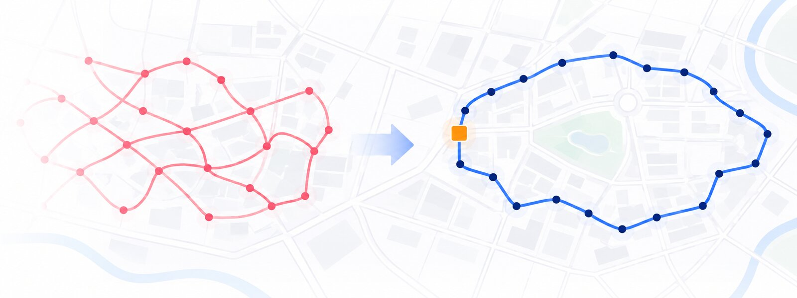
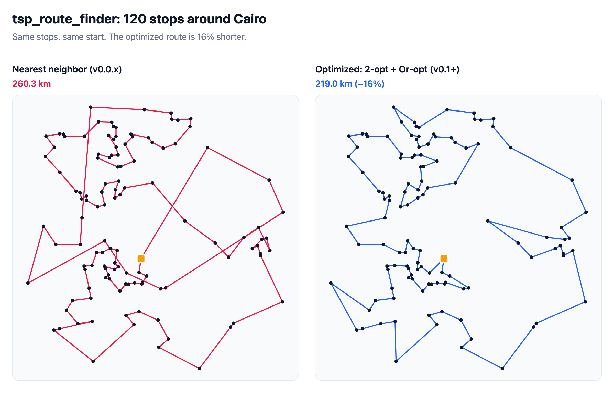
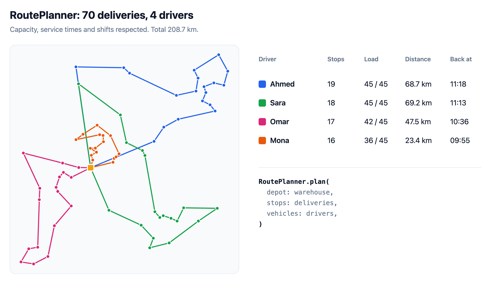
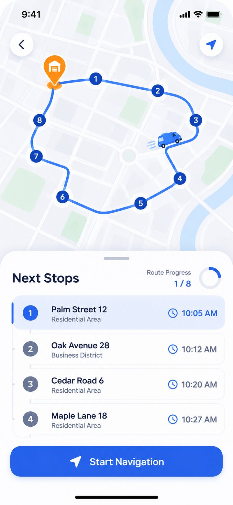

# tsp_route_finder



[](https://pub.dev/packages/tsp_route_finder)
[](LICENSE)

A fast, dependency-free **Traveling Salesman Problem (TSP)** solver for Dart and
Flutter. Give it a list of stops and it tells you the order to visit them so
the total distance is as short as possible. It works for delivery routes,
field-sales visits, pickup planning and trip itineraries.

It also plans **multi-vehicle deliveries** with capacities, time windows,
service times and driver shifts.



## Features

- **Optimal routes for small inputs.** Up to 12 stops are solved exactly by
  default (Held–Karp dynamic programming), and up to 16 on request.
- **Near-optimal routes for large inputs.** Nearest neighbor followed by
  **2-opt** and **Or-opt** local search. 1,000 stops take about 0.1 s.
- **Round trips or one-way routes**, with an optional fixed final stop.
- **Delivery planning for several vehicles** (`RoutePlanner`): vehicle
  capacity, per-stop time windows and service times, driver shifts, max stops
  per driver, different start / end locations, and even workload balancing.
- **Background solving.** `solveAsync` and `planAsync` run on a separate
  isolate so your Flutter UI never freezes.
- **GPS coordinates or your own costs.** Distance defaults to haversine
  (great-circle) km. You can also pass a custom distance function or a
  distance matrix, for example road distances or driving times from Google
  Distance Matrix, OSRM or Mapbox. **Asymmetric** matrices (one-way streets,
  traffic) are supported.
- **Pure Dart, no dependencies.** Runs on Android, iOS, web, Windows, macOS,
  Linux and the server, and works alongside `google_maps_flutter`,
  `flutter_map` or any other map package.

## New in 0.2.0

- **`RoutePlanner`: delivery planning for multiple vehicles** (a Vehicle
  Routing Problem solver).
  - **Vehicle capacity**: each `DeliveryStop` has a `demand`, and each
    `Vehicle` has a `capacity`.
  - **Time windows**: a stop can only be served between `earliest` and
    `latest`; vehicles wait if they arrive early.
  - **Service time** spent at each stop.
  - **Driver shifts** (`Vehicle.shift`) and **max stops per driver**.
  - **Different start and end locations per vehicle**, or one-way routes.
  - **`balance: true`** to spread stops evenly between drivers.
  - **Full schedule** for every route: arrival and service start times, end
    time, distance, driving time and load.
  - **Unservable stops** are returned in `plan.unassigned` instead of
    throwing.
- **`solveAsync`, `solveMatrixAsync` and `planAsync`.** Run the solver on a
  background isolate on Android, iOS and desktop, so the UI stays smooth. On
  the web they run asynchronously on the main thread, and the package still
  supports every platform.

## New in 0.1.0

- **Much better routes.** About 16% shorter than 0.0.x on typical inputs, and
  guaranteed optimal for small ones.
- **`TspRouteFinder.solve`.** New main entry point that returns a `TspResult`
  with `route`, `closedRoute`, `totalDistance`, `isOptimal`, `strategy` and
  `reorder()`.
- **`TspRouteFinder.solveMatrix`.** Optimize with real road distances or
  travel times, including asymmetric costs.
- **One-way routes.** Use `returnToStart: false`, and optionally set a fixed
  last stop with `endIndex`.
- **Custom distance functions**, through the `distance:` parameter.
- **Choice of algorithm** with `TspStrategy`, plus an optional `timeLimit`.
- **`TspLocation`** with `distanceTo()`, and the `haversineDistance()` and
  `TspRouteFinder.routeDistance()` helpers.
- **No Flutter dependency.** The package is now pure Dart, so it also runs on
  servers, CLIs and web/WASM.
- **Fully documented**, with a runnable example, tests and a benchmark.
- **Backwards compatible.** The 0.0.3 API still works (deprecated). See
  [Migrating from 0.0.x](#migrating-from-00x).

## Algorithms

| `TspStrategy` | Algorithm | Route quality | Speed | Max stops | Use when |
|---|---|---|---|---|---|
| `auto` (default) | `exact` up to 12 stops, `optimized` above | Optimal / near-optimal | Fast | Unlimited | You're not sure. This is the right choice almost always. |
| `exact` | Held–Karp dynamic programming, O(n²·2ⁿ) | **Optimal (guaranteed)** | ~14 ms for 16 stops | 16 | You need the provably shortest route. |
| `optimized` | Nearest neighbor + **2-opt** + **Or-opt** local search | Near-optimal (≈0.3% from optimal on 10–12 stops) | ~0.1 s for 1,000 stops | Thousands | Large inputs. Supports `timeLimit`. |
| `nearestNeighbor` | Greedy: always go to the closest unvisited stop | ~10–20% longer than optimal | Fastest, O(n²) | Thousands | Quick previews; the behaviour of v0.0.x. |

All strategies support round trips, one-way routes and fixed end stops, and
work with symmetric or asymmetric distances.

## Route quality

Average results on random stops around Cairo, from
[`benchmark/benchmark.dart`](benchmark/benchmark.dart):

| Stops | Nearest neighbor (v0.0.x) | Optimized (v0.1.0) | Optimal | Time |
|---:|---:|---:|---:|---:|
| 10 | 189.5 km | 168.2 km | 167.9 km | < 1 ms |
| 12 | 199.8 km | 180.9 km | 180.4 km | < 1 ms |
| 100 | 537.4 km | **449.1 km** (−16%) | – | < 1 ms |
| 500 | 1160.9 km | **975.5 km** (−16%) | – | 24 ms |
| 1000 | 1638.4 km | **1374.2 km** (−16%) | – | 105 ms |

## Installation

```sh
dart pub add tsp_route_finder
# or
flutter pub add tsp_route_finder
```

## Usage

```dart
import 'package:tsp_route_finder/tsp_route_finder.dart';

const stops = [
  TspLocation(latitude: 30.0454, longitude: 31.2332, name: 'Cairo'),
  TspLocation(latitude: 30.7865, longitude: 31.0012, name: 'Tanta'),
  TspLocation(latitude: 31.0407, longitude: 31.3804, name: 'Mansoura'),
  TspLocation(latitude: 24.0895, longitude: 32.8993, name: 'Aswan'),
  TspLocation(latitude: 31.2009, longitude: 29.9278, name: 'Alexandria'),
];

final result = TspRouteFinder.solve(stops, startIndex: 0);

print(result.route);          // [0, 3, 4, 1, 2]: indices in visiting order
print(result.closedRoute);    // [0, 3, 4, 1, 2, 0]: handy for a polyline
print(result.totalDistance);  // total km, including the way back
print(result.isOptimal);      // true: small inputs are solved exactly
print(result.reorder(stops)); // your objects, in visiting order
```

### One-way routes

```dart
// Start at the warehouse, end wherever is shortest.
TspRouteFinder.solve(stops, startIndex: 0, returnToStart: false);

// Start at the warehouse and finish at the driver's home (index 3).
TspRouteFinder.solve(stops, startIndex: 0, endIndex: 3, returnToStart: false);
```

### Road distances or travel times

Straight-line distance is a good approximation, but if you have real road
costs, pass them as a matrix where `matrix[i][j]` is the cost from `i` to `j`:

```dart
final minutes = [
  [0, 12, 30, 25],
  [14, 0, 18, 22],
  [28, 20, 0, 9],
  [26, 21, 11, 0],
];
final result = TspRouteFinder.solveMatrix(minutes);
```

Or plug in any cost function:

```dart
TspRouteFinder.solve(stops, distance: (a, b) => myCost(a, b));
```

### Choosing an algorithm

See the [Algorithms](#algorithms) table above for details.

```dart
// Guaranteed shortest route (up to 16 stops).
TspRouteFinder.solve(stops, strategy: TspStrategy.exact);

// Large input, stop improving after 200 ms.
TspRouteFinder.solve(
  manyStops,
  strategy: TspStrategy.optimized,
  timeLimit: const Duration(milliseconds: 200),
);
```

### Keep the UI smooth

```dart
// Runs on a background isolate (Android, iOS, desktop). On the web it runs
// asynchronously on the main thread.
final result = await TspRouteFinder.solveAsync(stops);
```

A custom `distance` function passed to `solveAsync` must be a top-level or
static function, or a closure that captures only plain data.

Draw the route with
`result.closedRoute.map((i) => LatLng(stops[i].latitude, stops[i].longitude))`.

## Delivery planning (multiple vehicles)

`RoutePlanner` splits stops between vehicles and orders each route, while
respecting capacity, time windows, service times and shifts. It minimizes the
total distance.



```dart
const warehouse = TspLocation(latitude: 30.044, longitude: 31.236);

final plan = RoutePlanner.plan(
  depot: warehouse,
  stops: [
    DeliveryStop(location: customerA, demand: 3),
    // Must be served between 09:00 and 10:00 (minutes after 08:00).
    DeliveryStop(location: customerB, demand: 5, timeWindow: TimeWindow(60, 120)),
    // Takes 10 minutes to unload.
    DeliveryStop(location: customerC, demand: 2, serviceTime: 10),
  ],
  vehicles: const [
    Vehicle(name: 'Ahmed', capacity: 40, shift: TimeWindow(0, 480)),
    Vehicle(name: 'Sara', capacity: 40, shift: TimeWindow(0, 480)),
    // Starts from home and does not return to the warehouse.
    Vehicle(name: 'Omar', capacity: 25, start: omarHome, returnToStart: false),
  ],
  averageSpeedKmh: 35, // Or pass travelTime: (a, b) => minutes from your API.
);

for (final route in plan.routes) {
  print('Vehicle ${route.vehicleIndex}: stops ${route.stops}, '
      '${route.distance.toStringAsFixed(1)} km, back at ${route.endTime} min');
}
if (!plan.isComplete) print('Could not serve: ${plan.unassigned}');
```

| Option | Where | Meaning |
|---|---|---|
| `demand` | `DeliveryStop` | Capacity used by the stop (parcels, kg, seats…). |
| `timeWindow` | `DeliveryStop` | When service may start. Early vehicles wait. |
| `serviceTime` | `DeliveryStop` | Minutes spent at the stop. |
| `capacity` | `Vehicle` | Maximum total demand. |
| `shift` | `Vehicle` | Departure time and the time it must be finished by. |
| `maxStops` | `Vehicle` | Maximum number of stops for this vehicle. |
| `start` / `end` / `returnToStart` | `Vehicle` | Own start location, own end location, or a one-way route. |
| `balance` | `RoutePlanner.plan` | Spread stops evenly between vehicles. |
| `travelTime` / `averageSpeedKmh` | `RoutePlanner.plan` | How driving time is calculated. |

<p align="center">
  
  <br><em>Concept illustration: a driver app showing the planned stops.</em>
</p>

Times are plain numbers in minutes. You pick the zero point, for example
`0` = 08:00. Use `RoutePlanner.planAsync` to plan in the background.

## Migrating from 0.0.x

The 0.0.3 API still works, but it is deprecated and will be removed in 1.0.0:

| 0.0.3 | 0.1.0 and later |
|---|---|
| `CitiesLocations(cityName: …, latitude: …, longitude: …)` | `TspLocation(name: …, latitude: …, longitude: …)` |
| `await TspPackage.calculateTspRoute(locations: l, startingLocationIndex: s)` | `TspRouteFinder.solve(l, startIndex: s).route` |
| `calculateDistance(a, b)` | `a.distanceTo(b)` or `haversineDistance(a, b)` |

`TspPackage.calculateTspRoute` now uses the improved algorithm automatically.

## Contributing

Issues and pull requests are welcome at
[github.com/kareemmohamed111/tsp_route_finder](https://github.com/kareemmohamed111/tsp_route_finder/issues).

## License

[MIT](LICENSE)
